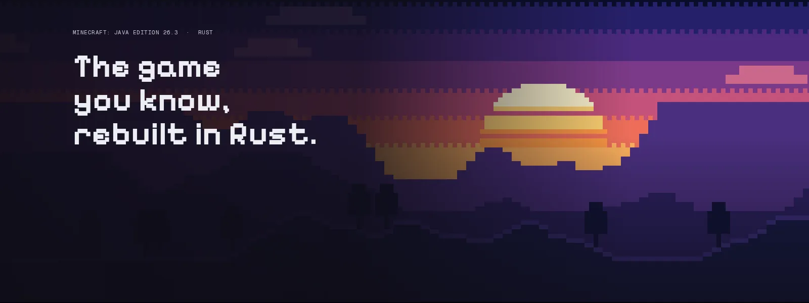

  

  <a href="#"><b>Website</b></a> ·
  <a href="#download"><b>Download</b></a> ·
  <a href="#"><b>Docs</b></a> ·

  
  

# Horizon webport

**Minecraft: Java Edition 26.3, rewritten in Rust.** Your worlds, the same rules and the same terrain as the Java game, checked against it by hundreds of differential tests, in one native program with no Java. Free, open source (MIT) and unofficial: you play it with your own chrome.
## What works today

Everything below is in the current release.

- **The game.** Survival, creative, hardcore and spectator; vanilla world generation in all three dimensions, mobs, villagers, raids, redstone, every command, the HUD and the recipe book. Vanilla saves open as they are, and worlds from 1.8 to 26.2 are upgraded.
- **Multiplayer is in working.** Join vanilla and Horizon servers (online mode included), open a world to LAN, or invite friends with a code from the launcher's Home page.
- **Graphics.** Distant terrain up to 1,024 chunks, graphics presets, HDR and controllers, all off by default where they would change the vanilla look 
- **Packs.** Resource packs, data packs and shader packs 
- **Mods.** Content mods and native Rust mods, 
 

Nightly 2026-11-05 on a Mac mini (Apple M4 Pro, Metal): vanilla's textures, no mods or shader packs, render distance 32 with distant terrain on.

## Performance

**Horizon draws more frames per second than Java Edition, and loads faster, on the same machine, world and path.** `tools/perf_bench.py` runs each game in turn, from a fresh world (seed 1234), waiting for the terrain and then flying it over a village, a forest, an ocean and a mountain. Measured on 2026-10-29/30 on an idle Windows 11 machine (Ryzen 7 9800X3D, RTX 5080), Horizon v0.2.97 as the launcher installs it, 1280x720 in a window, VSync off, three games per figure. Frames per second, mean of the four scenes, with the slowest 1% of frames in brackets:

| Render distance | Horizon v0.2.97 | Vanilla 26.3 | Vanilla + mods |
| --- | --- | --- | --- |
| 8 chunks | 3,289 (1,327) | 2,437 (640) | 2,375 (709) |
| 16 chunks | 2,074 (598) | 1,661 (375) | 1,586 (432) |
| 32 chunks | 1,207 (333) | 1,031 (176) | 879 (264) |

"Vanilla + mods" is Sodium, Lithium, FerriteCore and ImmediatelyFast. Horizon reaches the title screen in 2.9–3.2 s against vanilla's 7.5–7.7 s (the modded client's 10.8–11.1 s), loads a scene's chunks 2.9–3.8 times faster, and playing holds a steady working set of 1.1–1.7 GB against 1.9–2.9 GB. Every scene with its confidence interval and the run's load Method, and how to measure your own machine puts these runs beside a 2016 laptop, a Mac mini and a gaming desktop.

## Download 

I'm working to make it offline, and it's in the way

## play

| Platform | File | Needs |
| --- | --- | --- |
| Chromebooks | `index.html` | all from the link |
| Windows | `index.html` | all from the link |
| macOSs | `index.html` | all from the link |
| Linuxs | `index.html`  | all from the link |

## Mods and shader packs

- **Content mods** (`.hmod`): blocks, items, recipes, loot, models and textures, with no code.
- **Native mods** (`.hnmod`): Rust that the launcher compiles into the game for you, with nothing to install.
- **Java mods** (Fabric, NeoForge, Forge) don't run: Horizon has no Java. The launcher carries over the data and assets inside their jars, and imports modpacks (`.mrpack`, CurseForge zips, Prism instances) the same way ([modpacks](https://playhorizon.dev/docs/modpacks)).
- **Shader packs**: we have but need to see in (https://github.com/nobuildersnotools/horizon-web)
- 
Mods are off by default: a fresh install plays exactly like vanilla 26.3. The launcher's Mods page browses Horizon's registry and Modrinth. [Mods](https://playhorizon.dev/docs/mods) · .

Prepared files land in the gitignored `.local/`: never commit or share them. Options, controls and architecture: [the native client guide](docs/native-client.md); all developer docs: [docs/README.md](docs/README.md).

## Licence

[MIT](LICENSE), for the project's original work; dependencies keep their own licences ([notices](THIRD_PARTY_NOTICES.md)). Horizon is made by [Ludovic Marie](https://lu4ovic.com) ([@ludovic111](https://github.com/ludovic111)) and [its contributors](https://github.com/horizon-rust/horizon/graphs/contributors); support it on [GitHub Sponsors](https://github.com/sponsors/ludovic111).

NOT AN OFFICIAL MINECRAFT PRODUCT. NOT APPROVED BY OR ASSOCIATED WITH MOJANG OR MICROSOFT. Minecraft is a trademark of Mojang Synergies AB; its code and assets belong to Mojang and Microsoft under the [Minecraft EULA](https://www.minecraft.net/en-us/eula).

The browser port is by [OnyxSoul-1](https://github.com/OnyxSoul-1).
